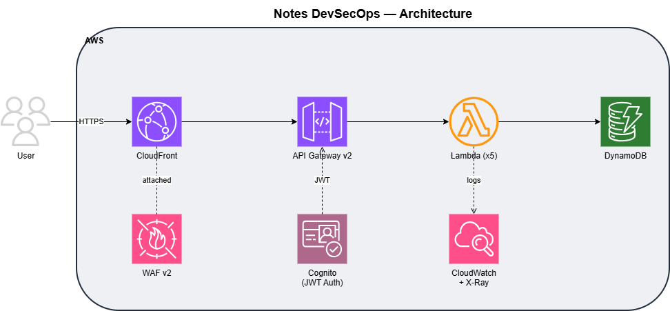

# Notes DevSecOps

A serverless notes API built to demonstrate DevSecOps best practices across development, security, and operations.

**Author:** Luis Del Valle

---

## Architecture



---

## Technologies

| Layer | Technology | Purpose |
|---|---|---|
| Infrastructure | Terraform | Infrastructure as Code |
| Compute | AWS Lambda (Python) | Business logic |
| Database | AWS DynamoDB | Data persistence |
| API | AWS API Gateway v2 (HTTP) | REST endpoints |
| Auth | AWS Cognito | JWT authentication |
| Security | AWS WAF v2 | Traffic filtering and rate limiting |
| CDN | AWS CloudFront | WAF integration and edge delivery |
| CI/CD | GitHub Actions + OIDC | Automated deployment |
| Observability | CloudWatch Logs + X-Ray | Logging and tracing |
| State | S3 | Remote Terraform state |

---

## Prerequisites

- [Terraform](https://developer.hashicorp.com/terraform/install) >= 1.10
- [AWS CLI](https://aws.amazon.com/cli/) configured with credentials
- AWS account with permissions to create the required resources
- GitHub repository with Actions enabled

---

## Deployment

### 1. Bootstrap — S3 state bucket

Create the S3 bucket for Terraform remote state before the first deploy:

```bash
aws s3api create-bucket \
  --bucket project1-terraform-state-delvalle \
  --region us-east-1
```

### 2. Configure GitHub Actions variables

Set the following variables in your GitHub repository (Settings → Secrets and variables → Actions):

**Variables:**
| Name | Example |
|---|---|
| `TF_VAR_COMPANY` | `jocalev` |
| `TF_VAR_PROJECT_NAME` | `project1` |
| `TF_VAR_SERVICE` | `notes` |
| `TF_VAR_ENVIRONMENT` | `dev` |
| `TF_VAR_REGION` | `us-east-1` |
| `TF_VAR_GITHUB_REPO` | `LuisMamey/Project1_DevSecOps` |

### 3. Bootstrap — OIDC and IAM role

The GitHub Actions role must be created locally on first deploy. This is a one-time bootstrap — the role does not exist yet so the pipeline cannot create it itself.

```bash
cd terraform
terraform init
terraform apply -target=aws_iam_openid_connect_provider.github \
                -target=aws_iam_role.github_actions_role \
                -target=aws_iam_role_policy_attachment.github_actions_policy
```

Once applied, get the role ARN from the output:

```bash
terraform output github_actions_role_arn
```

Add it as a secret in GitHub (Settings → Secrets and variables → Actions):

**Secrets:**
| Name | Description |
|---|---|
| `AWS_ROLE_ARN` | ARN from the previous step |

### 4. Deploy via pipeline

Open a pull request to `master`. The pipeline will:
1. Run unit tests
2. Run `terraform plan` and post the output as a PR comment

Merge to `master` to trigger `terraform apply`.

---

## Endpoints

All endpoints require a valid JWT in the `Authorization` header.

```
GET    /           List notes (supports ?limit=10&last_key=xxx pagination)
POST   /           Create a note
GET    /{id}       Get a note by ID
PUT    /{id}       Update a note
DELETE /{id}       Delete a note
```

Base URL is the CloudFront distribution URL output by Terraform.

---

## Architecture Decisions

**HTTP API v2 + CloudFront instead of REST API**
HTTP API v2 is ~70% cheaper and simpler to configure. It does not support direct WAF association, so CloudFront sits in front as the WAF target — which also adds DDoS protection and edge delivery.

**DynamoDB instead of RDS**
The data model is simple key-value with no relational requirements. DynamoDB scales automatically with Lambda, requires no server management, and has no fixed cost at low traffic.

**OIDC instead of static access keys for CI/CD**
GitHub Actions authenticates via OIDC, generating short-lived tokens per pipeline run. No credentials are stored in the repository, eliminating the risk of key leakage or rotation overhead.

**IAM least privilege per Lambda**
Each Lambda has its own execution role with only the DynamoDB actions it needs. A compromised function cannot affect other functions or other tables.
